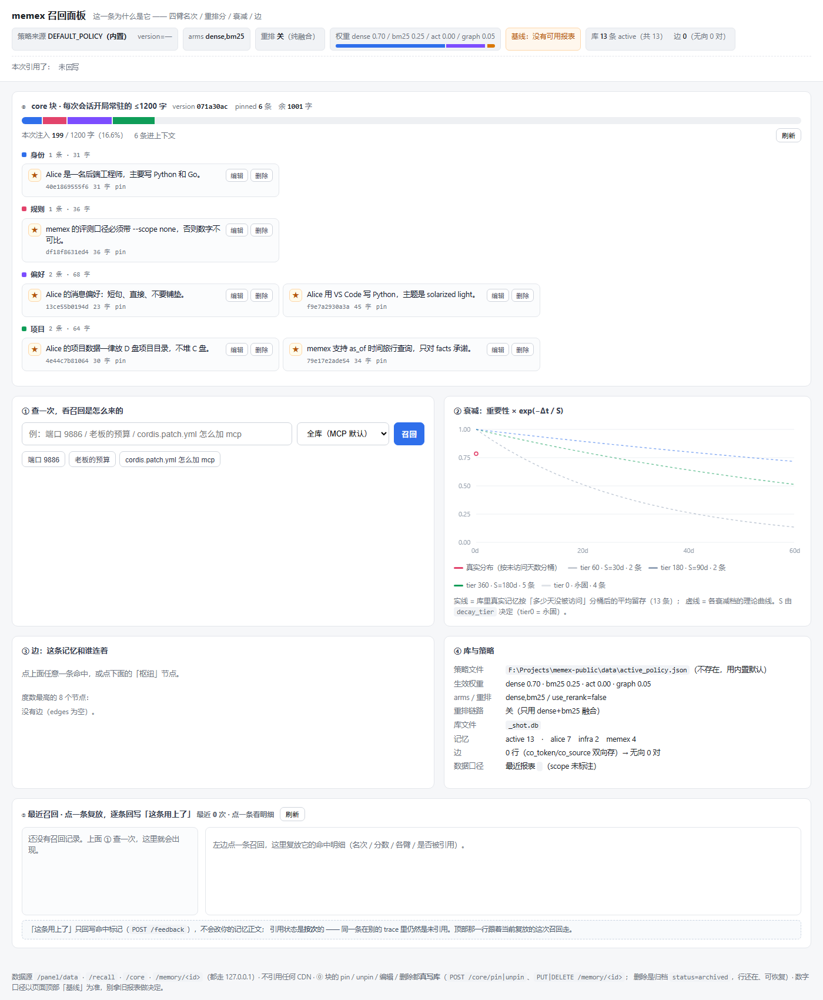

# memex

[](https://github.com/yg-memex/memex-memory/actions/workflows/ci.yml)

**A memory layer for people running several AI agents on one machine: one SQLite file, local, verifiable.** No cloud, no vendor lock-in, no memories silently summarised into something you can't audit.

> Status: **alpha (v0.1.0a1)**. Small API; versioned, self-migrating schema.

中文版：[README.md](README.md)

## Who it is for

**Yes, if:** you run 2+ AI clients on one machine and they don't remember each other; you already keep markdown notes and want agents to read them; you care about privacy and token cost.

**No, if:** you need team memory (accounts, permissions, multi-tenant), a zero-setup app, or cloud sync across devices.

It is not about remembering more. It is about every memory being provable, revertible, and traceable to what was said at the time.

## What it actually fixes

Agents forget between sessions, so you keep re-introducing yourself: who I am, where the project lives, what we decided last time, what not to do. memex stores those as short facts and brings them back when asked — nothing more.

## In 30 seconds

```
you: which TTS did I settle on?
memex: breeze (switched on 10-24), previously Qwen3; the reason was …
       [cited memory #3f9a, #8c21]
```

For that to work, four things must be true, and each has a verifiable implementation:

| Requirement | How memex does it | How it's proven |
|---|---|---|
| It knows who you are at session start | **Core block**: pinned identity/rules/preferences injected every session, hard 1200-char budget | Visible and editable in the panel; over-budget items are reported as `dropped`, never silently cut |
| Old facts come back first | **Four arms at once**: dense, BM25, graph, optional local rerank | 120-question golden set: Top1 84.2%, R@5 95.8% |
| Wrong memories can be fixed, old versions still queryable | Facts are **superseded, not overwritten**; `as_of` replays any date | 15-question temporal set: 86.7% vs 6.7% for current-only |
| You know whether a change helped | McNemar + bootstrap shipped in-repo; <5 pt is called noise | 10 self-checks per CI run; red means no merge |

## Standing on shoulders

Most of the ideas are borrowed from mature projects, then reshaped for *local + verifiable*:

| Borrowed | From | How memex lands it | Our trade-off |
|---|---|---|---|
| Always-on core memory | Letta / MemGPT | Slot-pinned rules/preferences/identity, 1200-char budget, `dropped` with reasons | No "ever-growing prompt": we drop and report instead of truncating |
| Facts expire, they aren't overwritten | Zep / Graphiti bi-temporal | `superseded_by` + `valid_from/valid_to` + `as_of` | Facts only; notes without a time chain are marked unsupported honestly |
| Write-time dedupe / merge | Mem0 memory operations | cosine > 0.92 merge, old row keeps the chain | No LLM extraction: no cost, latency, or hallucination; source text stays traceable |
| Small chunks, bigger context | RAG parent-document | Markdown-aware chunking shipped; parent backfill rejected | The rejection is logged too: +3 questions, p=0.45 — not significant |
| Paired significance + CIs | Standard eval practice | McNemar exact, 5000× bootstrap, MRR | On 120 questions CI is ±6.6 pt, so "+1 pt" is not a result here |
| Local reranking | Local cross-encoder setups | bge-reranker over HTTP, **off by default** | p95 160 ms with rerank; works without it |
| Visible, editable, attributable | ChatGPT / Claude memory panels | Panel pin/edit/delete, `trace_id` per recall, `cited` on hits | No black-box memory: every claim points back to a row |
| Engineering discipline | Mature OSS | Versioned migrations, one-command 10-item self-check, CI on 3.11/3.12 | No feature lands without an acceptance criterion |
| **Deliberately not copied** | — | Multi-tenancy, hosted cloud, vector DB, summary-replaces-source | One user + one SQLite file is the advantage |

## Quickstart

```bash
pip install -e .                       # numpy only; Python 3.11+
export MEMEX_EMBED_BASE=http://127.0.0.1:11434/v1   # any OpenAI-compatible /embeddings
export MEMEX_EMBED_MODEL=bge-m3
python tools/make_demo.py              # builds demo/memex-demo.db (synthetic data)
python tools/check_all.py              # offline self-check, should print GREEN
MEMEX_DB=demo/memex-demo.db python -m memex.http --port 8901   # panel: http://127.0.0.1:8901/
```

No embedding server? Install Ollama and `ollama pull bge-m3` — that is the intended offline setup. SiliconFlow / vLLM / LM Studio work too.



*The panel: core block by slot, budget usage, a recall sandbox, decay curves, policy/DB state. Everything shown is editable or deletable in place.*

### As an MCP server

```bash
pip install -e ".[mcp]"
```

```json
{"mcpServers":{"memex":{"command":"python","args":["-m","memex.server_mcp"]}}}
```

Tools: `recall`, `remember`, `stats`, `core`, `core_pin`, `core_unpin`, `memory_get`, `memory_update`, `memory_forget`.

### HTTP

| Method | Path | What |
|---|---|---|
| POST | `/recall` | `{q, k, scope}` → ranked hits with `trace_id`, each hit carries `cited` |
| POST | `/remember` | `{text, scope, kind, source, importance}` |
| GET | `/core?budget=1200` | rendered core block + `dropped` list |
| POST | `/core/pin`, `/core/unpin` | pin a memory into a slot (`identity/rule/preference/project/other`) |
| GET/PUT/DELETE | `/memory/<id>` | read, edit (re-embeds), archive |
| GET | `/traces?limit=20`, `/trace/<id>` | recent recalls / one replay |
| POST | `/feedback` | `{trace_id, hit_ids, used}` — the only real activation-decay signal |

## How it works

```
query ──► dense (bge-m3) ─┐
      ──► BM25 (SQLite)  ─┼─► normalize + weighted fusion ─► optional rerank ─► top-k
      ──► graph (edges)  ─┘
```

- Weights live in `data/active_policy.json` (falls back to `DEFAULT_POLICY`); every change is a file you can diff and roll back.
- The write path deduplicates by cosine > 0.92, supersedes instead of overwriting, and keeps a `superseded_by` chain.
- Schema v3, idempotent migrations; `as_of` filters on `valid_from/valid_to` (facts only).
- stdlib + numpy only. The reranker is an external HTTP process (`bge-reranker-v2-m3`) and is **off by default**.

## Current numbers (our own golden sets)

| Set | Top1 | R@5 | note |
|---|---|---|---|
| dev (120 q, incl. 22 negatives) | **84.2%** | **95.8%** | positive-only: 80.6% / 94.9% (n=98) |
| holdout v2 (186 q) | **72.6%** | **86.0%** | notes-heavy, harder |
| temporal (15 q, `as_of`) | **86.7%** | 100% | vs 6.7% current-only |

Two honest caveats:

1. On 120 questions the 95% CI is ~±6.6 pt. Differences under ~5 pt are noise; the repo ships the paired harness and refuses to call a change "better" unless `p < 0.05` **and** CI lower bound > 0.
2. Numbers were produced on one machine with rerank on. A measured state, not a leaderboard claim.

## Configuration

| Env | Default | Meaning |
|---|---|---|
| `MEMEX_DB` | `data/memex.db` (repo-relative) | database path |
| `MEMEX_EMBED_BASE` | `http://127.0.0.1:11434/v1` | OpenAI-compatible embeddings base |
| `MEMEX_EMBED_MODEL` | `bge-m3` | embedding model |
| `MEMEX_EMBED_KEY` | `ollama` | API key |
| `MEMEX_EMBED_TIMEOUT` / `_BATCH` | `60` / `32` | request tuning |
| `MEMEX_GOLDEN_DIR` | `eval/golden` | golden set dir for `eval_run` |

Rerank: set `"use_rerank": true` in `data/active_policy.json` and point `rerank_api_base` at a bge-reranker server.

## Repo map

```
memex/        library (recall, write, core, db, embed, http, server_mcp, eval)
tools/        make_demo.py, check_all.py, eval_stats.py
tests/        plain-python tests (no pytest needed)
demo/         synthetic demo database
docs/         architecture, evaluation notes, roadmap
panel/        single-file web panel (pin/unpin, edit, delete, trace replay)
examples/     MCP config, curl recipes
```

## Docs

- [Architecture](docs/architecture.md)
- [Evaluation methodology](docs/eval.md)
- [Roadmap](docs/roadmap.md)

## Contributing

Issues and PRs welcome. Two house rules: every behavioral change needs a falsifiable acceptance criterion, and no test may depend on the author's machine or private data.

MIT licensed.
