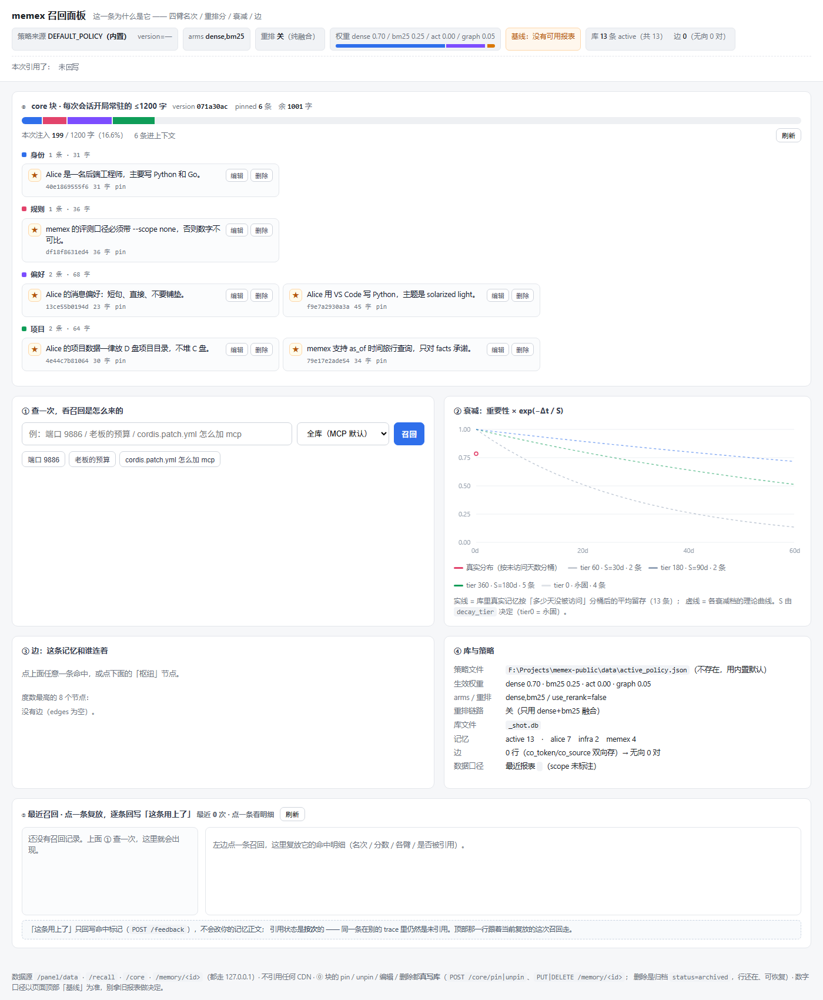

# memex

[](https://github.com/yg-memex/memex-memory/actions/workflows/ci.yml)

**给 AI 用的记忆库：一个 SQLite 文件，本地跑，记得住、查得准、还改得动。**

不联网、不绑供应商、不把记忆偷偷摘要成你审不了的东西。

> 状态：alpha（v0.1.0a1）。API 很小，够用；schema 带版本、自动迁移。

## 它到底解决什么

Agent 一换会话就失忆，于是你反复自报家门：我是谁、项目在哪、上次定了什么、哪些事别干。
把这几样长期记住，再让它在被问到时准确翻出来 —— 就这两件事。

## 30 秒看懂

```
你：我上次说 TTS 用哪个？
memex：breeze（10-24 换的），之前是 Qwen3；换的原因是……
       [引用了记忆 #3f9a、#8c21]
```

要让这句话成立，得同时做到四件事，memex 每件都做了一个能验证的版本：

| 要做到 | memex 的做法 | 怎么证明 |
|---|---|---|
| 一开口就知道你是谁 | **core 块**：身份/规则/偏好 pin 进去，每次会话自动注入，1200 字硬预算 | 面板上看得见、改得动；超预算如实报 `dropped` |
| 问一件旧事，第一条就是答案 | **四种找法同时上**：意思相近、关键词、关系网、再加一道本地精排 | 金标集 120 题，Top1 84.2%、前五 95.8% |
| 记错了能改，旧说法还能查 | **事实只被取代、不被覆盖**；`as_of` 回放某一天的说法 | 15 题时间金标：`as_of` 86.7%，现行对照只有 6.7% |
| 改了参数，能知道到底变好没有 | 仓库自带 McNemar + bootstrap；小于 5pt 一律叫噪声 | CI 每次跑 10 项自检，红的就合不进去 |

## 博采众长，但不照抄

这套东西不是凭空造的，亮点大多是从成熟项目里挑出来、再按「本地 + 可验证」改过的：

| 借鉴的点 | 从哪来 | memex 怎么落地 | 我们的取舍 |
|---|---|---|---|
| 核心记忆块常驻上下文 | Letta / MemGPT | rule/preference/identity 分槽 pin，1200 字预算，`dropped` 带原因 | 不做「越写越长的提示词」：超预算宁可少放，也不静默截断 |
| 事实过期是失效，不是覆盖 | Zep / Graphiti 的双时态 | `superseded_by` + `valid_from/valid_to` + `as_of` 查询 | 只对 facts 承诺；notes 没时间链就如实标 unsupported，不猜 |
| 写入时判重、合并 | Mem0 的记忆操作 | cosine > 0.92 合并，旧条留链 | 不用 LLM 抽记忆：省成本、省延迟、不引入幻觉，原文永远可追溯 |
| 小块检索、大块喂 | RAG 的 parent-document | 切块先做了 md 感知；父块回扩被我们否掉 | 否决也写进台账：+3 题但 p=0.45，不显著，不吹 |
| 配对显著性 + 置信区间 | 评测统计的标准做法 | 内置 McNemar 精确检验、5000 次 bootstrap、MRR | 120 题 CI ±6.6pt，所以「涨了 1pt」在这个仓库不算成绩 |
| 本地重排 | 本地 cross-encoder 实践 | 本机 bge-reranker 走 HTTP，**默认关** | 开着重排 p95 160ms；关掉也能跑，只是排序差一点 |
| 可见、可改、可删、标明出处 | ChatGPT / Claude 的记忆面板 | 面板 pin/编辑/删除，每条召回带 `trace_id`，答案能标 `cited` | 不做「黑盒记忆」：每条结论都能点回到具体那条记忆 |
| 工程纪律 | 成熟开源项目 | schema 迁移、一条命令 10 项自检、CI 跑 3.11/3.12 | 不为功能丢掉闸门：没有验收标准的改动不进 main |
| **明确不抄** | — | 多租户、云托管、向量数据库、自动摘要替代原文 | 单用户 + 一个 SQLite 文件才是它的优势 |

## 快速开始

```bash
pip install -e .                       # 只依赖 numpy，Python 3.11+
export MEMEX_EMBED_BASE=http://127.0.0.1:11434/v1   # 任何 OpenAI 兼容 /embeddings
export MEMEX_EMBED_MODEL=bge-m3
python tools/make_demo.py              # 生成 demo/memex-demo.db（全合成数据）
python tools/check_all.py              # 离线自检，应输出 GREEN
MEMEX_DB=demo/memex-demo.db python -m memex.http --port 8901   # 面板：http://127.0.0.1:8901/
```

没有 embedding 服务？装 Ollama 再 `ollama pull bge-m3`，这就是推荐的本地方案。硅基流动 / vLLM / LM Studio 也都能用。



*面板：按槽位分组的 core 块、预算占用、召回沙盒、衰减曲线、策略与库状态。界面上看到的都能就地改或删。*

### 作为 MCP 服务

```bash
pip install -e ".[mcp]"
```

```json
{"mcpServers":{"memex":{"command":"python","args":["-m","memex.server_mcp"]}}}
```

工具：`recall`、`remember`、`stats`、`core`、`core_pin`、`core_unpin`、`memory_get`、`memory_update`、`memory_forget`。

### HTTP 接口

| 方法 | 路径 | 作用 |
|---|---|---|
| POST | `/recall` | `{q, k, scope}` → 带 `trace_id` 的排序结果，每条 hit 带 `cited` |
| POST | `/remember` | `{text, scope, kind, source, importance}` |
| GET | `/core?budget=1200` | 渲染 core 块 + `dropped` 清单 |
| POST | `/core/pin`、`/core/unpin` | 把一条记忆 pin 进槽位（`identity/rule/preference/project/other`） |
| GET/PUT/DELETE | `/memory/<id>` | 读、改（会重算向量）、归档 |
| GET | `/traces?limit=20`、`/trace/<id>` | 最近召回 / 复放某一次 |
| POST | `/feedback` | `{trace_id, hit_ids, used}` —— 激活衰减唯一的真实信号 |

## 怎么工作的

```
query ──► 意思相近（bge-m3）──┐
      ──► 关键词（BM25）     ─┼─► 归一化 + 加权融合 ─► 可选重排 ─► top-k
      ──► 关系网（edges）    ─┘
```

- 权重在 `data/active_policy.json`（没有就用内置默认）；每次改都是一个能 diff、能回滚的文件。
- 写入按 cosine > 0.92 去重，用 supersede 代替覆盖，保留 `superseded_by` 链。
- schema 在 v3，迁移幂等；`as_of` 召回按 `valid_from/valid_to` 过滤（仅 facts）。
- 全部代码是标准库 + numpy。重排器是外部 HTTP 进程（`bge-reranker-v2-m3`），默认关闭。

## 当前数字（我们自己金标集上测的）

| 集合 | Top1 | R@5 | 备注 |
|---|---|---|---|
| dev（120 题，含 22 条负例） | **84.2%** | **95.8%** | 仅正题：80.6% / 94.9%（n=98） |
| holdout v2（186 题） | **72.6%** | **86.0%** | 偏 note，更难 |
| temporal（15 题，`as_of`） | **86.7%** | 100% | 现行对照只有 6.7% |

两句老实话，因为这个仓库讲的就是「可验证」：

1. 120 题的 95% 置信区间约 ±6.6 个百分点，小于 ~5pt 的差异一律算噪声。所以仓库自带配对检验，只有 `p < 0.05` **且** CI 下界大于 0 才允许说「变好了」。
2. 这些数字是在一台特定机器上、开着重排测出来的。它是一份测量结果，不是排行榜宣言。

## 配置

| 环境变量 | 默认值 | 含义 |
|---|---|---|
| `MEMEX_DB` | `data/memex.db`（相对仓库） | 数据库路径 |
| `MEMEX_EMBED_BASE` | `http://127.0.0.1:11434/v1` | OpenAI 兼容的 embeddings 地址 |
| `MEMEX_EMBED_MODEL` | `bge-m3` | embedding 模型 |
| `MEMEX_EMBED_KEY` | `ollama` | API key（Ollama 随便填） |
| `MEMEX_EMBED_TIMEOUT` / `_BATCH` | `60` / `32` | 请求调参 |
| `MEMEX_GOLDEN_DIR` | `eval/golden` | `eval_run` 用的金标目录 |

重排：在 `data/active_policy.json` 里设 `"use_rerank": true`，并把 `rerank_api_base` 指到 bge-reranker 服务。

## 目录

```
memex/        库（recall、write、core、db、embed、http、server_mcp、eval）
tools/        make_demo.py、check_all.py、eval_stats.py
tests/        纯 python 测试（不需要 pytest）
demo/         合成数据 demo 库
docs/         架构、评测说明、路线图
panel/        单文件网页面板（pin/unpin、编辑、删除、召回复放）
examples/     MCP 配置、curl 示例
```

## 文档

- [架构](docs/architecture.md)
- [评测方法](docs/eval.md)
- [路线图](docs/roadmap.md)

## 参与

欢迎 issue 和 PR。两条规矩：任何行为改动都要带一条可证伪的验收标准；测试不许依赖作者本机的数据或私有路径。

MIT 许可。
